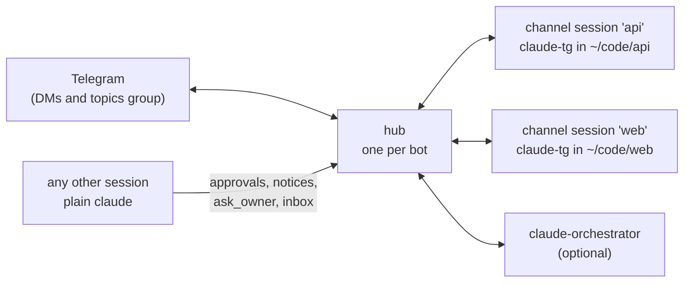
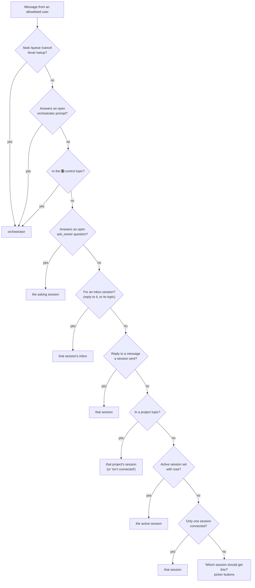

# Telegram Plus

Connect a Telegram bot to your Claude Code session with an MCP channel server.

Based on the official [`telegram` plugin](https://github.com/anthropics/claude-plugins-official/tree/main/external_plugins/telegram) (Apache-2.0), restructured into modules with tests, several security/reliability fixes, and richer inbound context. See [What's different](#whats-different-from-upstream).

## Setup

Setup takes about 10 minutes. Part 1 is all you need to chat with Claude from your phone. Part 2 adds one forum topic per project. It's optional, except **if you use [claude-orchestrator](#orchestrator-api), which needs Part 2**.

Each step says where to run it:

- 📱 **Telegram**: on your phone or in Telegram Desktop.
- 💻 **Terminal**: your normal shell (zsh/bash).
- 🤖 **Claude Code**: type it at the Claude Code prompt (commands starting with `/`).

### Before you start

- **Claude Code**, signed in with a claude.ai account or a Console API key. Channels don't work on Bedrock, Vertex or Foundry. Team/Enterprise orgs must turn channels on first.
- **Bun**. 💻 `curl -fsSL https://bun.sh/install | bash` (or `brew install oven-sh/bun/bun`). Check with `bun --version`.

### Part 1: chat with Claude in a DM

**Step 1. Create a bot.** 📱
Open [@BotFather](https://t.me/BotFather), send `/newbot` and follow the questions (a display name, then a username ending in `bot`). BotFather replies with a **token** that looks like `123456789:AAH…`. Keep it secret; anyone with it controls the bot.

**Step 2. Install the plugin.** 🤖
Start Claude Code anywhere (`claude`) and run:
```
/plugin marketplace add kusumachan/claude-telegram-plugin
/plugin install telegram-plus@telegram-plus-dev
```
Then run `/reload-plugins`, or quit and start Claude Code again. No need to clone the repo; Claude Code downloads it.

**Step 3. Save the bot token.** 🤖
```
/telegram-plus:configure 123456789:AAH...
```
The token is saved to `~/.claude/channels/telegram-plus/.env`. You only do this once.

**Step 4. Add the `claude-tg` command.** 💻
Add this line to `~/.zshrc` (or `~/.bashrc`), then open a new terminal:
```sh
claude-tg() { sh -c 'export TELEGRAM_PLUS_CHANNEL_PID=$$; exec claude --dangerously-load-development-channels plugin:telegram-plus@telegram-plus-dev "$@"' claude-tg "$@"; }
```
`claude-tg` starts Claude Code connected to Telegram. Plain `claude` still starts a normal session. [Why is this needed?](#why-a-launcher)

**Step 5. Start Claude with `claude-tg`.** 💻
Quit Claude Code, go to the project you want to work on, and start it with `claude-tg`:
```sh
cd ~/code/my-project
claude-tg
```
Claude Code may show a warning about development channels. Accept it. This session is now connected to Telegram.

**Step 6. Pair your Telegram account.** 📱 then 🤖
Keep the session from step 5 running. Send any message to your bot in Telegram. It replies with a code:
```
Pairing required — run in Claude Code:
/telegram-plus:access pair a1b2c3
```
Run that command in Claude Code. Send your bot another message: Claude now answers it in Telegram.

**Step 7. Lock the bot.** 🤖
```
/telegram-plus:access policy allowlist
```
From now on the bot ignores everyone you haven't paired. Do this as soon as everyone who should use the bot (usually just you) is paired.

**Check it.** 🤖 `/telegram-plus:access` shows your policy (`allowlist`) and your Telegram user id under `allowFrom`. Note the id; Part 2 needs it.

That's Part 1. Every time you want Claude on Telegram, start the session with `claude-tg`. Other sessions started with plain `claude` still send you approvals and "done" notices on Telegram ([details](#notifications-and-approvals-from-any-session)).

### Part 2 (optional): one topic per project

Required if you use claude-orchestrator.

Instead of a single DM, use a group with **Topics**. Each project gets its own topic, so chats, approvals and notices for `api` and `web` stay separate.

```
Group "Claude" (Topics on)
├─ api      ← talk to the api session; its approvals and notices land here
├─ web      ← same for web
└─ General  ← /sessions, picker, everything else
```

**Step 1. Create the group.** 📱
Create a new group (just you in it), open its settings and turn **Topics** on.

**Step 2. Add the bot as an admin.** 📱
Add your bot to the group, then make it an **admin** with the **Manage Topics** permission.

**Step 3. Let the bot see all messages.** 📱
In @BotFather send `/setprivacy`, pick your bot and choose **Disable**. Then **remove the bot from the group and add it again** (and make it admin again). Telegram only applies the privacy change when the bot rejoins.

**Step 4. Find the group id.** 📱
It's a negative number starting with `-100`, like `-1001234567890`.
- [Telegram Web](https://web.telegram.org/a): open the group; the id is in the address bar after `#`. If it shows `-123…` without the `100`, put `-100` in front of the digits.
- Telegram Desktop: Settings → Advanced → Experimental settings → turn on "Show Peer IDs in Profile", then open the group's profile.

**Step 5. Tell the plugin about the group.** 🤖
Replace the group id and your Telegram user id (from Part 1, "Check it"):
```
/telegram-plus:access group add -1001234567890 --no-mention --allow 412587349
/telegram-plus:access set topicsGroup -1001234567890
```
`--no-mention` lets you write without @mentioning the bot. `--allow` makes sure only you can talk to Claude in that group.

**Check it.** 💻 Start `claude-tg` in a project. A topic named after the project folder appears in the group with a welcome message. Write in that topic and Claude answers there.

If no topic appears, look at the end of `~/.claude/channels/telegram-plus/hub.log`. The usual cause is that the bot isn't an admin with Manage Topics, or Topics is off. Until it's fixed, everything goes to your DM.

### Troubleshooting

| Problem | Fix |
| --- | --- |
| The bot doesn't reply at all | Is a session started with `claude-tg` (not plain `claude`) running? Check `~/.claude/channels/telegram-plus/hub.log`. |
| "Pairing required" again after pairing | Run the exact `pair` command from the bot's latest message. Codes expire after an hour. |
| The bot ignores group messages | Privacy mode is still on: redo Part 2, step 3, including removing and re-adding the bot. |
| `/telegram-plus:...` commands don't exist | The plugin isn't loaded: run `/reload-plugins` or restart Claude Code. |
| A new version doesn't show up | Run `/plugin marketplace update telegram-plus-dev`, then `/plugin` → update telegram-plus, then restart Claude Code. |

### Good to know

- **Several bots:** give each one its own state directory with `TELEGRAM_STATE_DIR=/some/dir`.
- **Don't run this together with the official `telegram` plugin on the same token.** Telegram allows only one reader per bot. Their settings are kept apart (this one uses `channels/telegram-plus`), but the token can't be shared.
- A `TELEGRAM_BOT_TOKEN` in your shell overrides the saved token.

### Why a launcher?

Channels are a research preview. `--channels` only accepts plugins Anthropic has allowlisted, so this plugin needs the `--dangerously-load-development-channels` flag. `claude-tg` (or the equivalent script in this repo, [`bin/claude-telegram`](bin/claude-telegram)) runs `claude --dangerously-load-development-channels plugin:telegram-plus@telegram-plus-dev` for you. It works only in interactive sessions; the flag is ignored with `-p` and the Agent SDK.

It also marks its session as *the* channel session. Claude Code starts the plugin's server in **every** session where the plugin is enabled, and gives the server no way to tell whether that session registered it as a channel. Without the marker, every session would read the bot and push the others off. Sessions not started via the launcher run tools-only: they don't read the bot, but notifications, approvals and `ask_owner` still work.

Extra arguments pass through to `claude`. If you installed the plugin from a different marketplace, change `telegram-plus-dev` in the command (`bin/claude-telegram` reads `TELEGRAM_PLUS_PLUGIN` instead).

Working on the plugin itself? Clone the repo, run `/plugin marketplace add /path/to/clone` instead of the GitHub name, and see [Development](#development).

## How it fits together



- **The hub** (`hub.ts`) is the only process that talks to Telegram's `getUpdates`, so any number of sessions can share one bot without 409 conflicts. It starts automatically the first time something needs it and exits after 10 minutes with nothing connected. Log: `<state-dir>/hub.log`.
- **Channel sessions** are started with `claude-tg` (or `bin/claude-telegram`). Each registers with the hub under its project folder name (override with `TELEGRAM_PLUS_NAME=...`).
- **Every other session** with the plugin enabled is tools-only, and gets notifications and Telegram approvals through hooks.

## Multiple sessions

With several channel sessions connected, the hub decides where each message goes:



The plain-message rules for channel sessions, in order:

1. A **reply** to a message a session sent goes back to that session.
2. In a project's **forum topic**, it goes to that project's session (see [Forum topics](#forum-topics-one-topic-per-project)).
3. Otherwise it goes to the chat's **active** session: `/use api`, or tap one under `/sessions`.
4. With only **one** session connected, it goes there.
5. Otherwise the hub holds the message and asks *"Which session should get this?"* with a button per session.

Replies are prefixed with the session name (`[api] …`) whenever more than one is connected.

## Forum topics: one topic per project

Instead of switching with `/use`, every project gets its own topic in a Telegram forum group. Setup is in [Part 2](#part-2-optional-one-topic-per-project).

What happens:

- When a channel session connects, the hub creates a topic named after it, or reuses the existing one (`<state-dir>/topics.json`). Messages in that topic always go to that session. If it isn't running, the bot says so.
- Approval prompts and notices from any session (including `claude --bg` workers and worktrees) go to their project's topic, created on first use. Only allowlisted users can tap Allow/Deny there.
- Replies in a session's own topic skip the `[name]` prefix.
- If the bot can't create topics (no admin rights, Topics off), it logs why in `hub.log` and falls back to DMs. A topic deleted in Telegram is recreated on next use.

Everyone in the group can read what's posted there, including approval prompts with command previews. Keep the topics group to yourself or people you trust.

## Tools exposed to the assistant

| Tool | Purpose |
| --- | --- |
| `reply` | Send to a chat. `chat_id` + `text`, optional `thread_id` (forum topic), `reply_to`, `files` (photos/video/audio/documents, 50MB each), `format` (`text` / `html` / `markdownv2`), `buttons` (choice buttons). Auto-chunks; falls back to plain text if Telegram rejects the markup. |
| `react` | Emoji reaction from Telegram's fixed whitelist. |
| `edit_message` | Edit a message the bot sent (progress updates). Optional `buttons` replaces the keyboard; `[]` removes it. |
| `download_attachment` | Fetch an inbound attachment by `attachment_file_id` into the inbox (≤20MB). |
| `ask_owner` | Ask the owner a question and **block until they answer**. `question`, optional `buttons` (rows of labels). Works in every session, channel or not. See below. |

## Asking the owner (`ask_owner`)

Any session with the plugin enabled, including one not started with the launcher, can ask a question on Telegram and wait for the answer:

```json
{ "question": "Use Postgres or MySQL for project-x?", "buttons": [["Postgres", "MySQL"]] }
```

- The question is labeled with the session's name (`TELEGRAM_PLUS_NAME`, else the folder) and goes to the session's **project topic** when a topics group is set, otherwise to allowlisted DMs. The project is `TELEGRAM_PLUS_TOPIC` if set, else the session's folder (worktrees share their repo's topic). The same rule places that session's approvals and notices.
- The owner taps a button or types the answer. A reply to the question always counts. When it's the only open question in that topic or DM, any message there counts (except a reply to a session's message). With several open, a plain message gets a "reply to the one you're answering" hint. Only allowlisted users can answer, the same as approvals.
- The tool returns the answer text: the button label, or the typed reply.
- While it waits it sends MCP progress every 5s, because Claude Code aborts a tool call that is silent for 30s. After `askTimeoutMinutes` (default 240) it returns *"No answer yet; the question is still open…"*. Calling it again with the same question keeps waiting on the same question: it isn't posted twice, and an answer given in between is returned.
- Questions are kept in `<state-dir>/questions.json`, so they survive a hub restart. The hub keeps polling while any question is open, and drops questions nobody came back for after 7 days.

```
/telegram-plus:access set askTimeoutMinutes 60
```

## Messaging a running agent (inbox)

A session that isn't a channel session can't receive Telegram messages. With `TELEGRAM_PLUS_INBOX=1` in its environment it gets an inbox instead:

```sh
TELEGRAM_PLUS_INBOX=1 claude
```

Owner messages are queued in the hub and handed to the model by the plugin's hooks:

- **After the current tool call** (`PostToolUse`, as `additionalContext`), or
- **when the turn ends** (`Stop`, which blocks the stop with the message as the reason, so the agent keeps going; the terminal shows this as "Stop hook error", which is cosmetic).

Nothing can interrupt a running tool call. For a hard stop, kill the session.

What reaches the inbox, from allowlisted users only:

- A reply to (or tap on) one of the session's messages: its `ask_owner` questions and anything it sent with `reply`.
- Any message in its project topic (`TELEGRAM_PLUS_TOPIC`, else the folder) when it's the only inbox session there. With several, a plain message gets a "reply to a message from the one you mean" hint.
- A plain message still answers the single open `ask_owner` question in that topic first.
- Text only. Attachments get "Attachments aren't supported for agents."

The model sees `Message from the owner on Telegram (@you):\n<text>`, or for several at once `N messages from the owner on Telegram (@you), oldest first:\n[1] …\n[2] …`.

Feedback in Telegram: 👀 when queued, 👍 when delivered to the agent. If the session ends with messages still queued, the bot replies to them saying they weren't delivered. The queue lives in the hub's memory, so a hub restart drops it.

The hooks run after every tool call in every session, but without `TELEGRAM_PLUS_INBOX` they exit in the shell before starting anything. With it, they make one local socket call and never start the hub.

## Choice buttons

Claude can attach inline buttons to a reply instead of asking the user to type:

```json
{ "chat_id": "412587349", "text": "Deploy to production?", "buttons": [["Yes", "No"], [{ "text": "Changelog", "url": "https://example.com" }]] }
```

Tapping a label button sends it back to Claude as a new message (content = label, meta `button_choice`). The keyboard is then removed and the choice is appended under the question, so each prompt is single-use. Only people who could message the bot can tap: allowlisted users in DMs, and members of enabled groups (respecting the group's `allowFrom`). Labels are read back from the message itself, so buttons keep working across server restarts.

## Inbound context

Each message arrives as a `<channel>` notification with meta including `chat_id`, `message_id`, `thread_id` (forum topics), `user`, `user_name`, `chat_type`, `chat_title`, `reply_to_text` / `reply_to_user` (quoted message), `forwarded_from`, `media_group_id` (albums), `edited`, and attachment fields. Photos and images sent as files are downloaded eagerly (`image_path`); other attachments on demand. Locations and contacts are forwarded as text.

The typing indicator stays on while Claude works (refreshed every 4s, up to 3 min or until the reply). Inbox files older than 7 days are cleaned up automatically.

## Notifications and approvals from any session

The plugin ships [hooks](https://code.claude.com/docs/en/hooks) that work in every session where it's enabled, not only channel sessions.

**Approvals.** When a session (other than a channel session, which uses Claude Code's native relay) hits a permission prompt, allowlisted users get `🔐 [project] Permission: Bash` with **See more / Allow / Deny** buttons in their DM. The terminal dialog stays open at the same time, and whichever answer comes first wins. If you answer at the terminal, the Telegram prompt closes when the turn ends. With no answer within `approvalTimeoutSeconds` (default 300), the decision is left to the terminal.

```
/telegram-plus:access set approvals off                 # notify only, no buttons
/telegram-plus:access set approvalTimeoutSeconds 120
```

**Notifications** go to every allowlisted user when a session outside the channel session:

- needs attention: a permission prompt, a question, or idle waiting for input (`🔐` / `⏳`)
- finished a turn that took at least `notifyStopAfterSeconds` (default 60s), with the start of Claude's last message (`✅`)

The channel session itself is skipped, since there Claude already talks to you on Telegram. Notification hooks run async and never block Claude. With approvals on, the approval prompt replaces the plain "needs permission" notice.

```
/telegram-plus:access set notify off                  # disable
/telegram-plus:access set notifyStopAfterSeconds 300  # only turns ≥ 5 min (0 = every turn)
/telegram-plus:access set notifyPreview off           # don't include Claude's message text
```

In `-p` (headless) runs Claude Code cancels async hooks at teardown, so a "finished" notice may not arrive.

## Orchestrator API

**What it's for.** [claude-orchestrator](https://github.com/kusumachan/claude-orchestrator) turns one Telegram message into a pull request. You send `/task add a wishlist` in a project's topic, and it runs Claude Code sessions to analyze, build, review and test the change, asking you on Telegram at the gates you choose. It needs this plugin with a topics group ([Part 2](#part-2-optional-one-topic-per-project)). It creates the 🎛 Orchestrator control topic itself the first time it connects. You don't need `claude-tg` for it: its agents are plain `claude` sessions that use `TELEGRAM_PLUS_TOPIC` and `TELEGRAM_PLUS_INBOX`. To install it, see claude-orchestrator's `docs/installation.md`.

The rest of this section is for developers. A separate long-running process on the same machine (an orchestrator that runs Claude Code sessions for tasks) can use the hub too: [`src/hub/orchestrator.ts`](src/hub/orchestrator.ts) has the wire types and a small `OrchestratorClient`. It uses the same transport as everything else: HTTP over the hub's 0700 unix socket.

**Control topic.** When the orchestrator connects (with a topics group set), the hub creates a `🎛 Orchestrator` topic. Its key is `orchestratorTopic` in access, default `Orchestrator`. Every allowlisted plain message there goes to the orchestrator as a `message` event, never to a session, `ask_owner` or an inbox. The exception is answers to the orchestrator's own prompts there, which still arrive as `prompt_answer`. The bot reacts 👀. Attachments get "not supported", and with no orchestrator connected the bot replies "Orchestrator is not running." No session can use this key as its project topic: its questions, approvals and notices go to DMs instead.

**Commands in.** `/task <request>` (in a project topic), and `/queue`, `/cancel <id>`, `/level <0|1|2>` (topic or DM), `/setup <name> <repo-url>` (General topic, control topic or DM). Commands sent in the control topic carry `control: true` and no `topic`. These go to the orchestrator as `command` events, never to a session, and the bot reacts 👀. Only allowlisted senders, in DMs or the topics group. With no orchestrator connected the bot replies "Orchestrator is not running." Plain messages keep the routing above.

| Endpoint | Body | Returns |
| --- | --- | --- |
| `POST /orchestrator/connect` | `{}` | NDJSON stream: `hello`, `ping`, `command`, `message`, `prompt_answer`. One orchestrator at a time: the newest connection wins. |
| `POST /prompt` | `{ key?, topic?, text, buttons?, needs_text?, files?, format? }` | `{ id, message_ids }` or `{ error }` |
| `POST /prompt/ack` | `{ id }` | `{ ok }`: stop re-sending that answer |
| `POST /prompt/cancel` | `{ id, note? }` | `{ ok }`: buttons removed, `✖️ note` posted under it |
| `POST /notice` | `{ topic?, text?, files?, format? }` | `{ message_ids, messages: [{ chat_id, message_id, thread_id? }] }` or `{ error }` |
| `POST /notice/edit` | `{ chat_id, message_id, text, format? }` (one of the `messages` above) | `{ ok, unchanged?, plain? }` or `{ error, gone? }` |
| `POST /topic/ensure` | `{ topic }` | `{ chat_id, thread_id }` or `{ error }` |

`topic` is a project key (as in `topics.json`). Without one, or when the topic can't be used, messages go to allowlisted DMs.

Status messages edited in place: keep a ref from `/notice` (it's plain data, so it still works after a restart) and pass it to `/notice/edit` with the new text. "Not modified" counts as success (`unchanged`). If Telegram rejects the markup the text is edited as plain text (`plain`). `gone` means the message was deleted or can't be edited any more, so post a new notice. Without a topic a notice goes to every allowlisted DM, and a ref edits only that one copy.

Gate prompts:

- Files are sent first and the text with the buttons last. A tap answers with its `label`.
- A `needs_text` button (e.g. `Revise`) asks the owner to type notes, and the answer carries both `label` and `text`. A typed reply to the prompt answers with `text` only.
- Allowlisted users only.
- Prompts are kept in `prompts.json`. Answers given while the orchestrator is disconnected are re-sent on every connect until acked. The same `key` never posts twice.

See [ACCESS.md](./ACCESS.md).

## Development

```sh
bun install
bun test          # unit + hub integration tests (fake Bot API)
bun run typecheck # tsc --noEmit
```

`@modelcontextprotocol/sdk` is pinned to an exact version on purpose: Claude Code doesn't register a channel server that negotiates MCP protocol revision `2026-07-28`. The pinned SDK negotiates `2025-11-25`. Check the protocol version before bumping it.

```
hub.ts               the hub: polling, routing, approvals, local API
server.ts            MCP server: hub client (channel) or direct tools-only
src/hub/router.ts    which session gets a message
src/hub/client.ts    hub socket, auto-start, wire types
src/topics.ts        forum topic per project (topics.json)
src/access.ts        access.json store (locked read-modify-write)
src/lock.ts          cross-process mkdir lock
src/gate.ts          inbound gate + mention detection
src/inbound.ts       Telegram handlers → channel notifications, bot commands
src/tools.ts         MCP tool definitions + handlers
src/permissions.ts   permission-prompt relay
src/typing.ts        typing indicator keep-alive
src/text.ts          chunking, formatting fallback, sanitizers
src/buttons.ts       choice-button keyboards + tap resolution
src/files.ts         downloads, sendable check, inbox cleanup
src/cli.ts           access CLI used by the /access skill
src/channel-mode.ts  detects the launcher-started channel session
src/notify.ts        notification-hook decisions
hooks/               hooks.json, notify.ts, permission.ts
bin/claude-telegram  launcher for the channel session
```

## What's different from upstream

**Security fixes**
- Text permission replies (`yes abcde`) are only accepted from DM-allowlisted users in private chats. Upstream accepted them from any member of an allowlisted group.
- The access skill no longer rewrites `access.json` by hand. It calls a CLI that shares a lock with the server, so pairing codes can't be clobbered by a race.
- The pending-pairing cap is configurable (`maxPending`, default 10, up from 3), so a few strangers can't block legitimate pairing for an hour.

**Reliability**
- Only the launcher-started session polls Telegram. Upstream's MCP server polls in every session where the plugin is enabled, and each new session kills the previous session's poller. Verified: Claude Code starts the server, with identical env and handshake, whether or not the session registered it as a channel.
- Permission prompts are tracked per message. When answered (button, text, or after a 30-min expiry), every copy is updated and the request is forgotten. Upstream leaked memory and left stale buttons.
- Photo downloads check the HTTP status and sanitize the extension. A failed download still passes `attachment_file_id` so Claude can retry.
- Chunking never splits emoji. A parse error in `html`/`markdownv2` falls back to plain text instead of failing mid-reply.
- A persistent 409 keeps retrying slowly instead of leaving the bot permanently deaf. A 401 (bad token) stops with a clear message.
- Size is checked before download, and the inbox is cleaned up.
- `zod` is declared explicitly, plus a tsconfig and tests.
- Permission-reply ack uses 👍/👎. Upstream's ✅/❌ aren't in Telegram's reaction whitelist and silently failed.

**Features**
- Several sessions on one bot through the hub, with `/sessions`, `/use` and reply-based routing
- One forum topic per project: routing, approvals and notices per topic
- Approve permission prompts from Telegram for any session, not just the channel one
- Notification hooks: Telegram ping when any other session needs attention or finishes a long turn
- Forum topics (`thread_id` in and out)
- Reply/quote context, forwarded-from, edited messages, albums, locations, contacts
- Choice buttons for Claude (`buttons` on `reply` / `edit_message`)
- `html` format
- Video and audio file sending
- Persistent typing indicator
